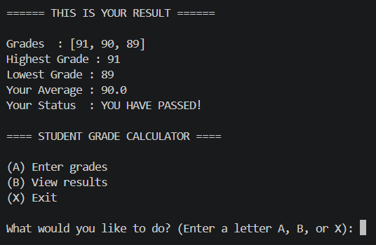
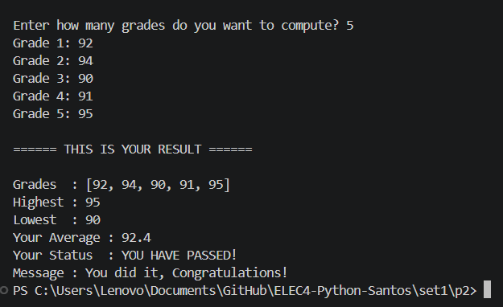
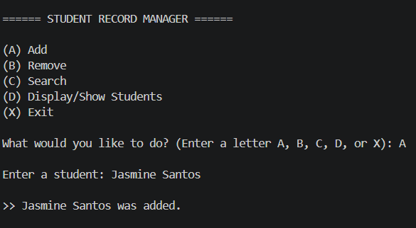
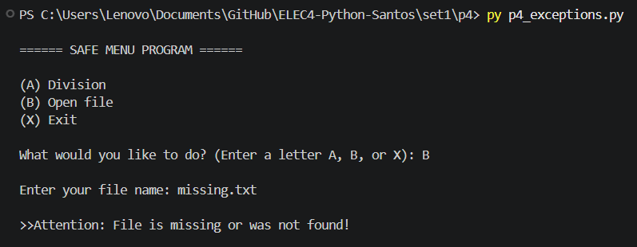

# ELEC 4 - Python Programming

Full name: Jasmine De Leon Santos
Section: IV-BSIT-B
Course: ELEC 4 - Python Programming

This repository contains my activities for ELEC 4 - Python Programming

## Set 1 Activities

| Activity                     | Description                                                                                             | Folder            |
| ---------------------------- | ------------------------------------------------------------------------------------------------------- | ----------------- |
| P1: Student Grade Calculator | A menu program that computes the average, highest, lowest, and pass/fail result using functions.        | [set1/p1](set1/p1) |
| P2: Custom Module            | A custom module `student_utils` used by `p2_main.py`, with a built-in module and two import styles. | [set1/p2](set1/p2) |
| P3: Student Record Manager   | A program that can add, remove, search, and display a student names using a set and a list.             | [set1/p3](set1/p3) |
| P4: Safe Menu Program        | A menu program that handles bad input with try, except, else, and finally.                              | [set1/p4](set1/p4) |

## How to Run

Open a terminal in the root of this repository, then run:

| Activity | Command                                         |
| -------- | ----------------------------------------------- |
| P1       | `python set1/p1/p1_grade_calculator.py`       |
| P2       | `python set1/p2/p2_main.py`                   |
| P3       | `python set1/p3/p3_record_manager.py`         |
| P4       | `cd set1/p4` then `python p4_exceptions.py` |

For P4, run it from inside the `set1/p4` folder so the program can find `file_test.txt`.

## Screenshots

### P1: Student Grade Calculator

### P2: Custom Module: student_utils

### P3: Student Record Manager

### P4: Safe Menu Program

